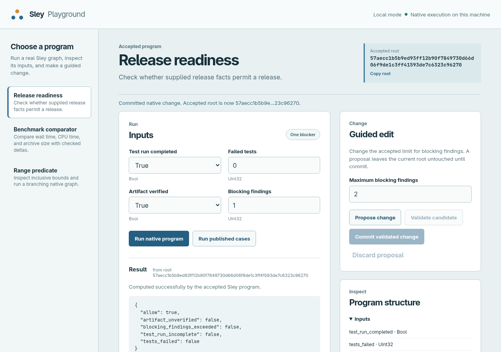
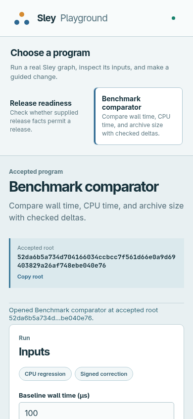

# Local Playground browser review — 2026-09-27

The local service was opened in Chromium through Playwright CLI at `http://127.0.0.1:4177`, using the selected Sley 2.0.1 binary and `target/debug/sley-tools`. The browser used the actual loopback service, not a mocked API.

- Selected Release Readiness, ran the supplied one-blocker input, and observed a successful native computation with `allow=false` at the displayed accepted root.
- Proposed `max_blocking_findings=2`, validated the candidate, and confirmed the root remained unchanged until commit. Commit changed the displayed root and the same input returned `allow=true`. The before/after panel showed both values and the candidate and receipt identities.
- Selected Benchmark Comparator, inspected its typed fields and accepted constants, and entered `banana` as a signed input. The UI showed the precise input problem while retaining the accepted root.
- Reviewed the desktop layout at 1280 px and the Comparator layout at 390 px. The first mobile inspection exposed horizontal overflow; the grid track sizing was corrected. The exact 64-character accepted root was then made visible in the UI, and a follow-up mobile check found and removed extra root-card height. At 390 px, `document.documentElement.scrollWidth` was 390 px and the root card was 100 px tall. No page-load console errors remained after the no-session response and favicon were corrected.

Desktop: 

Mobile: 

This is a manual browser check. The [local service probe](local-v0.json) separately verifies HTTP behavior, per-session scope, native edits, and fresh export replay. Hosted worker isolation and disconnection recovery under a killed backend remain unverified.
